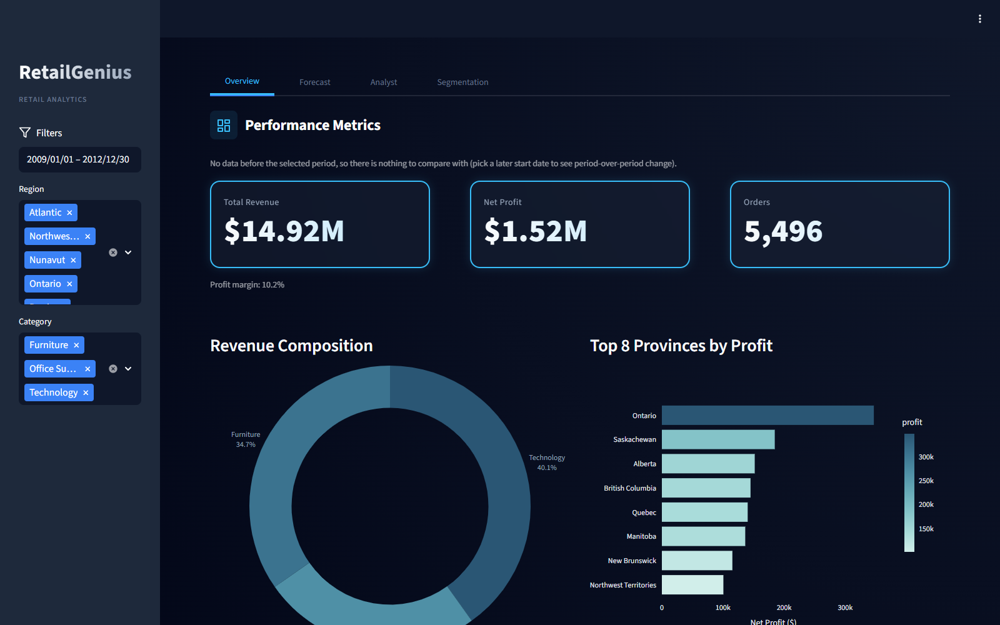
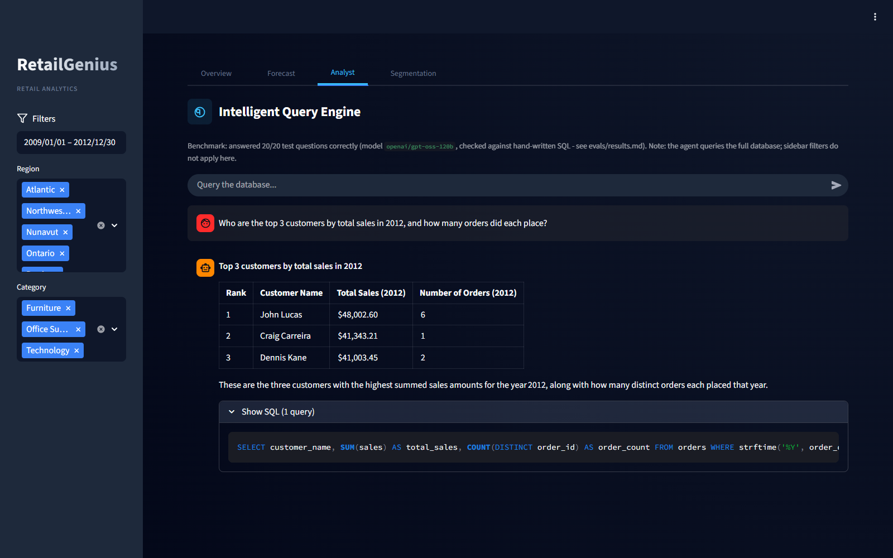
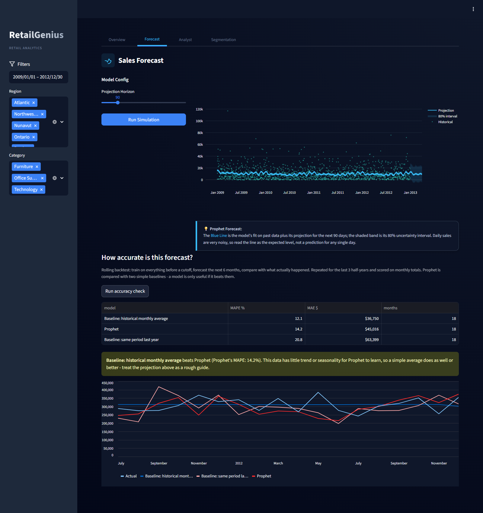
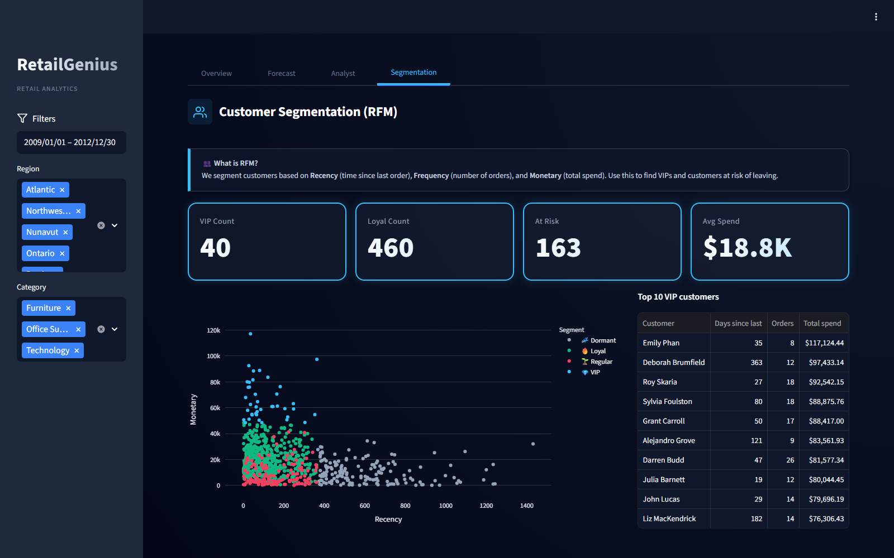

# RetailGenius: Retail Analytics with an Evaluated LLM SQL Agent

[](https://github.com/Malatesh0811/RetailGenius/actions/workflows/tests.yml)


**Live demo:** _coming soon_ <!-- replace with the Streamlit Cloud URL after deploying (docs/DEPLOYMENT.md) -->

A Streamlit analytics app on 4 years of retail orders (8,399 order lines, 5,496 orders, 795 customers) with four parts:

| | What it does | How it's checked |
|---|---|---|
| **Overview** | Revenue, profit, orders, with % change vs the previous period of the same length | Unit tests; numbers match hand-written SQL |
| **Analyst** | Ask questions in plain English; an LLM agent writes and runs SQL | **20/20** on a 20-question benchmark with SQL-computed answers |
| **Forecast** | Prophet sales projection with an 80% uncertainty band | Rolling backtest against two baselines (a baseline wins, and the app says so) |
| **Segmentation** | RFM customer segments (VIP, Loyal, Dormant, Regular) | Unit tests on hand-built data |



---

## Highlights

### 1. LLM SQL agent, safe and measured
- **Read-only by design:** the agent's SQLite connection is opened with `mode=ro`, so SQLite itself rejects
  `INSERT/UPDATE/DELETE/DROP`. Even a prompt-injected query cannot change data. Tested in `tests/test_agent.py`.
- **Transparent:** every answer has a "Show SQL" expander with the exact queries the agent ran.
- **Evaluated:** 20 questions whose correct answers come from hand-written SQL, graded by code (number within
  tolerance / name present), not by another LLM. Report: [evals/results.md](evals/results.md).

| Run | Agent setup | Score |
|---|---|---|
| v1 | LangChain's default SQL prompt | 18/20 |
| v2 | + notes on table structure (a row is an order *line*; dates stored as text) | **20/20** |

v1's real error was counting product rows as orders (335 instead of 123 customers with 10+ orders). Its other
miss came from an ambiguous question, which was reworded for v2. Twenty questions is a small benchmark, so treat it
as a regression check, not a guarantee.



### 2. Forecast with an honest backtest
Train on everything before a cutoff, forecast the next 6 months, compare with what happened. This is repeated for
3 half-years (18 monthly predictions per model) and scored on monthly totals, because daily sales are mostly noise.

| Model | Monthly MAPE | MAE |
|---|---|---|
| Baseline: historical monthly average | **12.1%** | $36,750 |
| Prophet | 14.2% | $45,016 |
| Baseline: same period last year | 20.8% | $63,399 |

Sales in this dataset are nearly flat, with weak seasonality, so Prophet does **not** beat a simple average.
The app shows this table and states the result rather than hiding it. Reproduce it with `python -m retailgenius.forecasting`.



### 3. RFM segmentation
Recency (days since last order), Frequency (distinct orders) and Monetary (total sales) per customer. Rules, first match wins:
top 5% spenders → VIP, no order for over a year → Dormant, 5+ orders → Loyal, everyone else → Regular.



---

## Tech stack
- **App:** Streamlit, Plotly
- **LLM agent:** LangChain (tool-calling SQL agent) + Groq (default model `openai/gpt-oss-120b`, configurable)
- **Data:** pandas, SQLite (built from `Superstore.xls` by a small ETL)
- **Forecasting:** Prophet
- **Quality:** pytest (45 tests, no API key needed), GitHub Actions CI

## Project structure
```
app.py                  Streamlit UI only (layout, widgets, charts)
retailgenius/
  data.py               load + validate the orders table, filter_orders()
  analytics.py          KPIs, period-over-period change, RFM segmentation
  forecasting.py        Prophet forecast + rolling backtest vs baselines
  agent.py              LangChain SQL agent on a read-only SQLite connection
  evaluation.py         20-question agent benchmark + deterministic grader
  etl.py                Superstore.xls -> sales.db
  ui.py                 theme CSS, icons, small HTML helpers
tests/                  pytest suite
evals/                  agent benchmark reports (v1 baseline + latest)
docs/                   build notes per phase, deployment guide, screenshots
```

## Run it locally
```bash
git clone https://github.com/Malatesh0811/RetailGenius.git
cd RetailGenius
python -m venv venv
venv\Scripts\activate            # macOS/Linux: source venv/bin/activate
pip install -r requirements.txt
```

The Analyst tab needs a free Groq API key from https://console.groq.com/keys. Copy
`.streamlit/secrets.toml.example` to `.streamlit/secrets.toml` and paste the key there. That file is git-ignored.
The other tabs work without a key.

```bash
streamlit run app.py                     # run from the project folder so .streamlit/ is found
```

Other commands:
```bash
pip install -r requirements-dev.txt && pytest     # tests (no API key needed)
python -m retailgenius.forecasting                # forecast backtest table
python -m retailgenius.evaluation                 # agent benchmark (uses the Groq key, about 10 min)
python -m retailgenius.etl                        # rebuild sales.db from Superstore.xls
```

## Limitations
- The data is a public sample dataset (2009-2012), not live data. The sidebar filters do not apply to the agent,
  which queries the full table.
- Agent answers take about 20-30 s (several LLM calls per question) and depend on Groq's free-tier rate limits.
- The 20-question benchmark covers single-table analytics questions, not every kind of question.

## How it was built
The project was rebuilt in six documented phases: cleanup, bug fixes, refactor and tests, forecast evaluation,
agent evaluation, and deployment. The notes in [docs/](docs/) explain each decision, including the bugs found along the way
(for example, RFM was counting product rows as orders, which put 78 customers in the wrong segment).
